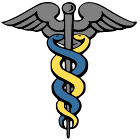

# Clinical Text Tagging App

A Streamlit app that tags clinical notes with medspaCy: target concepts, section detection and ConText modifiers (such as negation), shown with displaCy.



## Run it

```bash
pip install -r requirements.txt
streamlit run medspacy_streamlit_final.py
```

Sentence splitting rules are in `rush_rules.tsv`.
